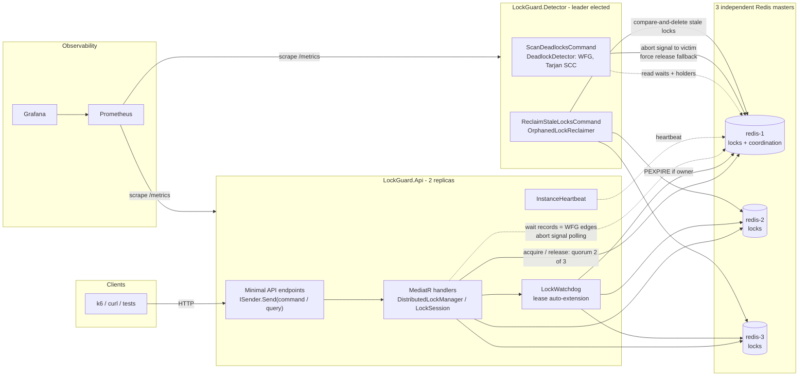
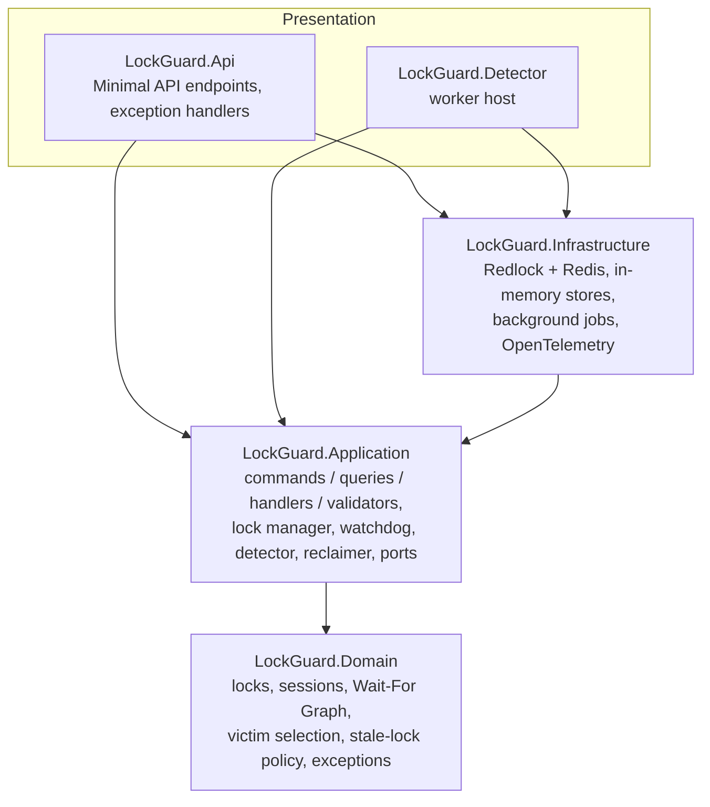
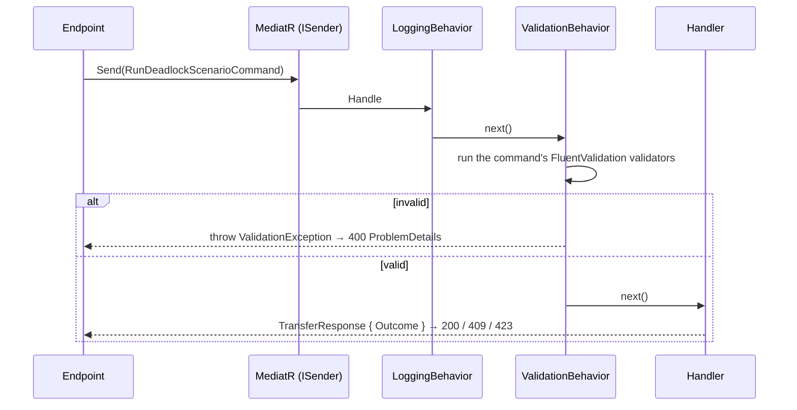
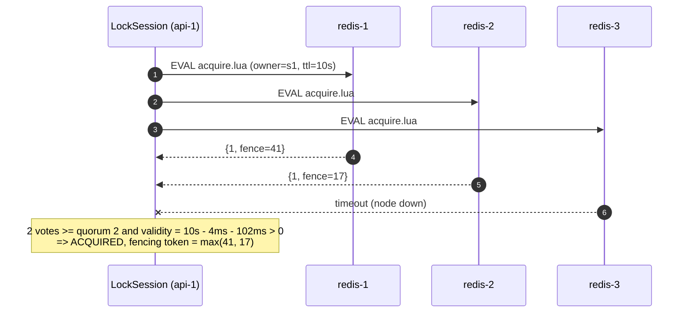
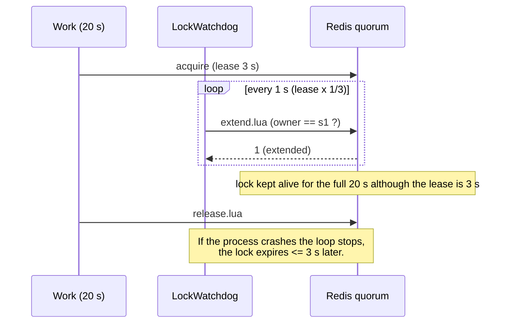
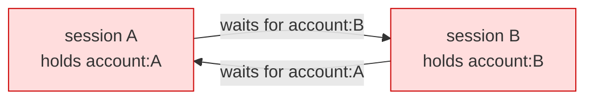
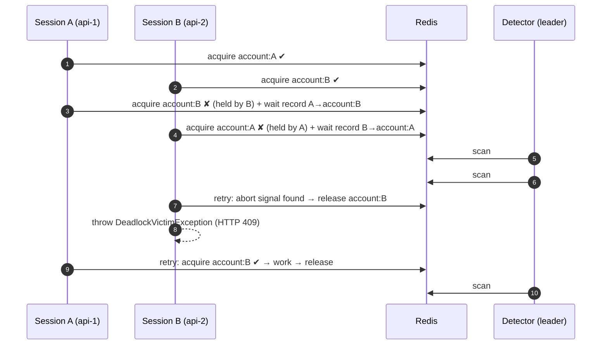

# Distributed Lock Deadlock Detector

[](https://github.com/batuhan-basay/distributed-lock-deadlock-detector/actions/workflows/ci.yml)


A production-grade distributed locking and deadlock detection engine built with **.NET 10**, **Redis (Redlock)** and
**OpenTelemetry**, to monitor, detect and resolve **lock contention**, **deadlocks** and **stale / orphaned locks** in
microservices.

> Single-topic proof of concept: everything in this repository exists to show how distributed locks fail in practice,
> and how to detect and recover from each failure safely.

---

## Table of contents

- [The problem](#the-problem)
- [What LockGuard does](#what-lockguard-does)
- [Architecture](#architecture)
- [Clean Architecture and CQRS (MediatR)](#clean-architecture-and-cqrs-mediatr)
- [Redlock, TTL and the lock watchdog](#redlock-ttl-and-the-lock-watchdog)
- [Re-entrant and idempotent acquisition](#re-entrant-and-idempotent-acquisition)
- [Deadlock detection: the Wait-For Graph](#deadlock-detection-the-wait-for-graph)
- [Orphaned / stale lock reclamation](#orphaned--stale-lock-reclamation)
- [Quick start (`docker compose up`)](#quick-start-docker-compose-up)
- [Simulating deadlocks and reading the resolution reports](#simulating-deadlocks-and-reading-the-resolution-reports)
- [Load tests with k6](#load-tests-with-k6)
- [Observability](#observability)
- [Configuration](#configuration)
- [Tests](#tests)
- [Project structure](#project-structure)
- [Design decisions and limitations](#design-decisions-and-limitations)

---

## The problem

A distributed lock (one key in Redis that says "session X owns resource R") looks simple. In a microservice landscape
it fails in four classic ways:

| Failure | What happens | Typical symptom |
|---|---|---|
| **Deadlock** | Service A holds `account:A` and waits for `account:B`; service B holds `account:B` and waits for `account:A`. | Both requests hang until their timeouts fire; throughput collapses under load. |
| **Orphaned lock** | A pod crashes / is OOM-killed while holding a lock. | The resource is blocked until the TTL expires (or forever if the lock has no TTL). |
| **Premature expiry** | The work takes longer than the TTL; the lock silently expires and a second worker enters the critical section. | Double processing, lost updates. |
| **Contention** | Many sessions compete for one hot key. | High lock wait latency, timeouts, retries amplifying the load. |

## What LockGuard does

| Capability | Where |
|---|---|
| **Redlock** over N independent Redis masters (quorum `N/2+1`, clock-drift aware validity) | [`RedlockLockStore`](src/LockGuard.Infrastructure/Persistence/Redis/RedlockLockStore.cs), [Lua scripts](src/LockGuard.Infrastructure/Persistence/Redis/Scripts) |
| **Lock watchdog**: short TTL + automatic lease extension while the work runs; lost-lease notification | [`LockWatchdog`](src/LockGuard.Application/Locking/Watchdog/LockWatchdog.cs) |
| **Re-entrant, idempotent sessions**: same session re-enters its locks; a retried request with the same idempotency key adopts its lock instead of deadlocking on itself | [`LockSession`](src/LockGuard.Application/Locking/LockSession.cs), [`acquire.lua`](src/LockGuard.Infrastructure/Persistence/Redis/Scripts/acquire.lua) |
| **Fencing tokens** on every fresh acquisition | `LockHandle.FencingToken` |
| **Wait-For Graph deadlock detector** (Tarjan SCC), phantom-deadlock guard, victim selection, cooperative abort + forced fallback | [`WaitForGraph`](src/LockGuard.Domain/Deadlocks/WaitForGraph.cs), [`DeadlockDetector`](src/LockGuard.Application/Detection/DeadlockDetector.cs) |
| **Deadlock prevention** with global lock ordering | `LockSession.AcquireOrderedAsync` |
| **Orphaned lock reclaimer**: crashed instance, never-seen instance, no-expiry key, zombie hold time | [`StaleLockPolicy`](src/LockGuard.Domain/Reclamation/StaleLockPolicy.cs), [`OrphanedLockReclaimer`](src/LockGuard.Application/Reclamation/OrphanedLockReclaimer.cs) |
| **Leader election** for the detector / reclaimer (built on the lock store itself) | [`LeaderElection`](src/LockGuard.Application/Coordination/LeaderElection.cs) |
| **Observability**: OpenTelemetry metrics + traces, Prometheus scrape endpoint, provisioned Grafana dashboard | [`LockGuardTelemetry`](src/LockGuard.Application/Common/Telemetry/LockGuardTelemetry.cs), [`deploy/`](deploy) |
| **Simulation API**: deadlock scenarios A/B, three-way cycle, crash, watchdog, contention – each one a MediatR command | [`Features/Simulations`](src/LockGuard.Application/Features/Simulations), [`SimulationEndpoints`](src/LockGuard.Api/Endpoints/SimulationEndpoints.cs) |
| **Clean Architecture + CQRS**: Domain / Application / Infrastructure / Presentation, MediatR commands & queries, FluentValidation pipeline | [see below](#clean-architecture-and-cqrs-mediatr) |

## Architecture



**Data model.** Locks are written to every Redis node (Redlock). Advisory coordination data lives on one node
(`CoordinationNodeIndex`): losing it never breaks mutual exclusion, it only delays detection.

| Key | Type | Content |
|---|---|---|
| `lg:lock:{resource}` | HASH (all nodes) | `owner` (session id), `service`, `instance`, `acquired`, `fence` + PX TTL |
| `lg:fence` | STRING (all nodes) | monotonically increasing fencing counter |
| `lg:waits` | HASH | session id → `WaitRecord` JSON: an edge of the Wait-For Graph |
| `lg:sessions` | HASH | session id → session metadata (priority, start time) |
| `lg:instances` | HASH | instance id → last heartbeat (unix ms) |
| `lg:abort:{session}` | STRING + TTL | abort signal for a deadlock victim / reclaimed lock owner |
| `lg:events` | LIST (capped) | detection / resolution / reclamation reports |

## Clean Architecture and CQRS (MediatR)

The solution is split into four layers; dependencies only point inwards.



| Layer | Contains | Depends on |
|---|---|---|
| **Domain** | Entities / value objects (`LockOwner`, `LockInfo`, `SessionInfo`, `WaitRecord`), the pure algorithms (`WaitForGraph` with Tarjan SCC, `DefaultDeadlockVictimSelector`, `StaleLockPolicy`) and domain exceptions | nothing (no NuGet packages) |
| **Application** | Ports (`ILockStore`, `ICoordinationStore`), application services (`DistributedLockManager`, `LockSession`, `LockWatchdog`, `DeadlockDetector`, `OrphanedLockReclaimer`), and every use case as a MediatR **command** or **query** with its **handler** and FluentValidation **validator** | Domain, MediatR, FluentValidation |
| **Infrastructure** | Adapters: `RedlockLockStore` + Lua scripts, `RedisCoordinationStore`, in-memory stores; hosted jobs (heartbeat, watchdog loop, leader-elected detector / reclaimer that **send commands**); OpenTelemetry | Application |
| **Presentation** | `LockGuard.Api` (endpoints only build a request and call `ISender.Send`) and `LockGuard.Detector` (worker host) | Application, Infrastructure (composition root) |

**One folder per use case, one class per file:**

```text
LockGuard.Application/Features/
├── Simulations/
│   ├── Common/                         # ScenarioOutcome, TransferResponse, DTOs
│   └── Commands/
│       ├── RunDeadlockScenario/        # RunDeadlockScenarioCommand, ...Handler, ...Validator
│       ├── RunOrderedTransfer/
│       ├── RunThreeWayDeadlock/        # + ThreeWayDeadlockResponse, ThreeWayWorkerResult
│       ├── RunContention/              # + ContentionResponse
│       ├── RunLongRunningJob/          # + LongRunningJobResponse
│       ├── SimulateCrashedOwner/       # + CrashedOwnerResponse
│       └── RunReentrantScenario/       # + ReentrantScenarioResponse, ReentrantAcquisitionDto
├── Locks/
│   └── Queries/
│       ├── GetLocks/                   # GetLocksQuery, ...Handler, ...Validator, LockDto
│       ├── GetWaitForGraph/            # + WaitForGraphResponse, CycleDto, WaitForGraphMermaidRenderer
│       ├── GetLockEvents/              # GetLockEventsQuery, ...Handler, ...Validator
│       ├── GetSessions/
│       └── GetInstances/               # + InstanceDto
└── Maintenance/
    └── Commands/
        ├── ScanDeadlocks/              # sent every second by the leader-elected detector worker
        └── ReclaimStaleLocks/          # sent every 2 s by the leader-elected reclaimer
```

**Request pipeline.** Every request goes through two MediatR pipeline behaviors before its handler:



* **Validation** failures become `400` problem details (`ValidationExceptionHandler`).
* **Business outcomes** (`Completed`, `DeadlockVictim`, `Timeout`, `LockLost`, `ResourceBusy`, `Accepted`) are part of the
  response (`IScenarioResponse.Outcome`) and mapped to HTTP status codes in one place (`ScenarioResultExtensions`).
* Lock exceptions that escape a handler are mapped by `DistributedLockExceptionHandler` (409 / 423).
* The detector worker is just another MediatR client: its hosted services send `ScanDeadlocksCommand` and
  `ReclaimStaleLocksCommand` in a fresh DI scope on every tick, while this instance holds the leader lease.

> MediatR is pinned to **12.5.0**, the last Apache-2.0 release (13.x and later require a commercial license key).

## Redlock, TTL and the lock watchdog

### Redlock in one paragraph

With `N` independent masters, a client: (1) records the start time; (2) runs the atomic acquire script on all nodes
in parallel with a small per-node timeout; (3) the lock is acquired **only if** at least `N/2 + 1` nodes granted it
**and** the remaining validity `ttl − elapsed − drift` is positive, where `drift = ttl × 0.01 + 2 ms`;
(4) otherwise it immediately releases the partial acquisition on every node. Release and extension are
compare-and-set operations on the owner, so nobody can release or extend a lock they do not own.



The Lua scripts (`src/LockGuard.Infrastructure/Persistence/Redis/Scripts`) are small and atomic:

| Script | Semantics |
|---|---|
| `acquire.lua` | free → `HSET` owner/service/instance/acquired/fence + `PEXPIRE` → `1`; **same session** → refresh TTL, adopt the new instance → `2` (idempotent); other owner → `0` + holder + PTTL |
| `extend.lua` | `PEXPIRE` only if `owner == session` |
| `release.lua` | compare-and-delete; also used for **forced** release by the reclaimer and the detector |
| `inspect.lua` | owner fields + PTTL in one atomic read (`PTTL = -1` → lock without expiry) |

### TTL vs. watchdog

A long TTL makes crashes expensive (the resource is blocked until the TTL elapses); a short TTL makes long work
unsafe (the lock expires in the middle of the critical section). The **watchdog** removes the trade-off:

* every lock is written with a **short lease** (default 10 s);
* while the session holds it, the watchdog extends it every `LeaseTime × RenewalRatio` (default ⅓, the Redisson
  convention) – with the same Redlock quorum rule;
* if the process dies, extensions stop and the lock disappears after at most one lease;
* if an extension fails (lock expired or was reclaimed), the session is told immediately: `session.LockLost` is
  cancelled and `EnsureLocksHeld()` / `EnsureLocksHeldAsync()` throw `LockLostException`, so work bound to the token
  stops **before** it commits.



### Fencing tokens

Every fresh acquisition gets a token from a monotonic counter (`INCR lg:fence`). A GC pause or a network partition can
still make a client *believe* it owns a lock that expired; storage that accepts writes guarded by a lock should reject
writes whose fencing token is lower than the last one it saw. `LockHandle.FencingToken` exposes it.

## Re-entrant and idempotent acquisition

A **session** is the logical owner (a transaction, an HTTP request, a saga step) – not a thread and not a process.

* **Re-entrant:** `session.AcquireAsync("order:42")` three times returns three handles; only the first touches Redis.
  The lock is released when the outermost handle is disposed. Disposing the session releases everything.
* **Idempotent:** pass a stable `SessionId` (e.g. the request's idempotency key, header `X-Lock-Session-Id` in the API).
  If a client times out and retries, possibly on **another replica**, the retry's acquire returns `AlreadyOwned`
  (the lock adopts the live instance) instead of waiting on its own abandoned lock.

```csharp
await using var session = await locks.BeginSessionAsync(new() { SessionId = idempotencyKey, Name = "transfer" }, ct);
await using var from = await session.AcquireAsync("account:A", ct);
await using var to   = await session.AcquireAsync("account:B", ct);

await DoTransferAsync(from.FencingToken, session.LockLost);   // critical section bound to lock ownership
await session.EnsureLocksHeldAsync(ct);                       // verify ownership right before committing
```

## Deadlock detection: the Wait-For Graph

Every contended acquisition publishes (and refreshes on each retry) a **wait record**: *session W waits for resource
R*. The detector resolves the **current** holder `H` of every waited resource and builds the graph
`W ──R──▶ H`. A deadlock exists **iff** the graph has a cycle.



**Algorithm** (`DeadlockDetector.ScanAsync`, every 1 s, only on the elected leader):

1. Load wait records, drop stale ones (not refreshed for `WaitRecordStaleAfter`: waiter crashed or gave up).
2. Resolve current holders with a quorum read and build the graph.
3. Find strongly connected components with an **iterative Tarjan** (O(V+E), no recursion limit); for each non-trivial
   SCC extract the shortest concrete cycle for the report.
4. **Phantom deadlock guard:** the snapshot is not atomic, so a cycle must be seen in `ConfirmationScans` (2)
   consecutive scans before anything happens.
5. **Victim selection** (`DefaultDeadlockVictimSelector`): sessions without metadata first, then lowest `Priority`,
   then fewest held locks (cheapest rollback), then the youngest session, then a deterministic tiebreak.
6. **Cooperative abort:** the victim gets an abort signal. Its acquisition loop sees it on the next retry, **releases
   all its locks** (victim rollback) and throws `DeadlockVictimException` – the API returns `409` (`retryable: true`)
   or retries the unit of work with backoff.
7. **Forced fallback:** if the cycle is still there after `VictimForceReleaseAfter` (victim hung, or a non-LockGuard
   client), the detector force-releases the victim's locks with compare-and-delete.
8. When the cycle disappears, a `DeadlockResolved` report records the time-to-resolve.



**Prevention** is cheaper than detection whenever all resources are known up front:
`session.AcquireOrderedAsync(["account:B", "account:A"])` always locks in ordinal order, so two sessions can never
form a cycle (`/api/test/deadlock-scenario-safe`).

## Orphaned / stale lock reclamation

Every process sends a heartbeat. The reclaimer (leader-elected, every 2 s) classifies every lock:

| Reason | Condition | Typical cause |
|---|---|---|
| `owner_instance_dead` | owning instance's heartbeat older than `InstanceStaleAfter` (10 s) | pod crashed / killed / partitioned |
| `owner_instance_unknown` | owning instance never sent a heartbeat (or was purged) | process died right after acquiring |
| `no_expiry` | key has no TTL (`PTTL = -1`) | legacy client, manual `HSET`, bug |
| `max_hold_time_exceeded` | held longer than `MaxHoldTime` (5 min) | zombie whose watchdog keeps a stuck lock alive |

Locks younger than `MinLockAge` are never touched (race with the first heartbeat). Release is a **compare-and-delete
on the observed owner**, so a lock that was meanwhile re-acquired by a healthy session is never stolen. The previous
owner also receives an abort signal and its watchdog reports the lease as lost, so a zombie that is still alive stops
before committing. Sessions, wait records and heartbeat entries of dead instances are purged.

## Quick start (`docker compose up`)

Requirements: Docker with Compose v2. Optional: .NET 10 SDK (tests), [k6](https://k6.io) (load tests).

```bash
git clone https://github.com/batuhan-basay/distributed-lock-deadlock-detector.git
cd distributed-lock-deadlock-detector
docker compose up --build -d
```

| Service | URL | Notes |
|---|---|---|
| API replica 1 | http://localhost:8081 | `/api/test/*`, `/api/locks/*`, `/metrics`, `/health` |
| API replica 2 | http://localhost:8082 | same image, different instance id |
| Detector worker | internal (`detector:8080`) | `docker compose up -d --scale detector=2` to watch leader election |
| Prometheus | http://localhost:9090 | scrapes all .NET processes every 5 s |
| Grafana | http://localhost:3000 | anonymous viewer, dashboard **LockGuard** is the home page (admin/admin) |
| Redis nodes | localhost:6379 / 6380 / 6381 | three independent masters |

Without Docker (single process, in-memory stores, detector + reclaimer inside the API):

```bash
cd src/LockGuard.Api
ASPNETCORE_ENVIRONMENT=Development LockGuard__Store=InMemory dotnet run
```

## Simulating deadlocks and reading the resolution reports

All requests are also in [`docs/requests.http`](docs/requests.http). The JSON below was captured from a real local run
of these endpoints (single API process with `LockGuard__Store=InMemory`, detector and reclaimer enabled; session ids
shortened). Against the Compose stack the responses have the same shape; only instance names differ.

Every simulation response carries an `outcome`: `Completed` → **200**, `Accepted` → **202**,
`DeadlockVictim` / `LockLost` / `ResourceBusy` → **409**, `Timeout` → **423**. Invalid input → **400**.

### 1. Two-party deadlock across two replicas

```bash
curl -s -X POST "http://localhost:8081/api/test/deadlock-scenario-a?holdMs=1500" &
curl -s -X POST "http://localhost:8082/api/test/deadlock-scenario-b?holdMs=1500"
```

One request completes, the other is the victim (`409`):

```json
{ "outcome": "Completed", "scenario": "scenario-b", "sessionId": "s-6e4303c8…", "attempts": 1, "previousAttempts": [],
  "lockOrder": [ { "resource": "account:B", "fencingToken": 1 }, { "resource": "account:A", "fencingToken": 2 } ],
  "elapsedMs": 3772, "retryable": false }
```

```json
{ "outcome": "DeadlockVictim", "scenario": "scenario-a", "sessionId": "s-ff275a6a…", "attempts": 1, "lockOrder": [],
  "detail": "deadlock cycle [s-6e4303c8… -[account:A]-> s-ff275a6a… -[account:B]-> s-6e4303c8…] detected by local-api; 's-ff275a6a…' selected as victim",
  "elapsedMs": 3358, "retryable": true }
```

With `?maxRetries=2` the victim backs off, retries the unit of work in a new session and **both** return `200`:

```json
{ "outcome": "Completed", "scenario": "scenario-b", "sessionId": "s-fb5c93e5…", "attempts": 2,
  "previousAttempts": [ { "sessionId": "s-0bbca9ce…", "outcome": "DeadlockVictim", "detail": "deadlock cycle […]" } ],
  "lockOrder": [ { "resource": "account:B", "fencingToken": 4 }, { "resource": "account:A", "fencingToken": 4 } ],
  "elapsedMs": 5321 }
```

While the two sessions are stuck, the live graph is available as JSON + Mermaid (`GetWaitForGraphQuery`):

```bash
curl -s http://localhost:8081/api/locks/wait-graph
```

```text
deadlocked: true
graph LR
  n0["s-6e4303c8…"] -- "waits for account:A" --> n1["s-ff275a6a…"]
  n1["s-ff275a6a…"] -- "waits for account:B" --> n0["s-6e4303c8…"]
  style n0 fill:#ffdddd,stroke:#cc0000
  style n1 fill:#ffdddd,stroke:#cc0000
```

### 2. Three-party cycle

```bash
curl -s -X POST http://localhost:8081/api/test/three-way-deadlock
```

```json
{ "scenario": "three-way-deadlock", "outcome": "Completed", "victims": 1, "completed": 2,
  "workers": [
    { "worker": 1, "path": "ledger:1 -> ledger:2", "outcome": "Completed", "elapsedMs": 3325 },
    { "worker": 2, "path": "ledger:2 -> ledger:3", "outcome": "Completed", "elapsedMs": 2964 },
    { "worker": 3, "path": "ledger:3 -> ledger:1", "outcome": "DeadlockVictim", "elapsedMs": 2818,
      "detail": "deadlock cycle [s-55df… -[ledger:3]-> s-d408… -[ledger:1]-> s-6e40… -[ledger:2]-> s-55df…] …" } ] }
```

The detector then writes a resolution report (`GET /api/locks/events?kind=DeadlockResolved`):

```json
{ "kind": "DeadlockResolved",
  "summary": "Deadlock [s-55df… -[ledger:3]-> s-d408… -[ledger:1]-> s-6e40… -[ledger:2]-> s-55df…] resolved 2003 ms after first detection by aborting s-d408….",
  "victimSessionId": "s-d408…", "cycle": [ /* the three WaitEdges */ ], "detectedBy": "local-api" }
```

### 3. Crashed process, orphaned lock (600 s TTL)

```bash
curl -s -X POST "http://localhost:8081/api/test/crash-simulation?resource=payment:tx-1001&ttlSeconds=600"
curl -s "http://localhost:8081/api/locks/events?kind=OrphanedLockReclaimed&count=1"
```

```json
{ "outcome": "Accepted", "resource": "payment:tx-1001", "ttlSeconds": 600, "orphanSessionId": "s-orphan-1ef1…",
  "deadInstanceId": "crashed-7bc077a0", "expectedReclaimWithin": "~5s (MinLockAge + ScanInterval) instead of 600s" }
```

```json
[ { "kind": "OrphanedLockReclaimed",
    "summary": "Reclaimed 'payment:tx-1001' from session s-orphan-1ef1… on instance crashed-7bc077a0 (held 3.4s, reason: owner_instance_unknown).",
    "resource": "payment:tx-1001", "reason": "owner_instance_unknown", "detectedBy": "local-api" } ]
```

### 4. Watchdog on / off

```bash
curl -s -X POST "http://localhost:8081/api/test/long-running?workMs=5000&leaseMs=1500"
# {"outcome":"Completed","leaseMs":1500,"workMs":5000,"watchdogEnabled":true,"expectedExtensions":10,"elapsedMs":4995,...}

curl -s -X POST "http://localhost:8081/api/test/long-running?workMs=3000&leaseMs=1000&disableWatchdog=true"
# {"outcome":"LockLost","reason":"lock on 'report:monthly' is no longer owned by this session (lease expired or reclaimed)",
#  "hint":"watchdog disabled: the lease expired while the work was still running",...}
```

### 5. Re-entrancy and idempotent session id

```bash
curl -s -X POST -H "X-Lock-Session-Id: order-42-req" "http://localhost:8081/api/test/reentrant?resource=order:42&depth=3"
```

```json
{ "outcome": "Completed", "resource": "order:42", "sessionId": "order-42-req", "holdCount": 3,
  "acquisitions": [ { "level": 1, "isReentrant": false, "fencingToken": 1 },
                    { "level": 2, "isReentrant": true,  "fencingToken": 1 },
                    { "level": 3, "isReentrant": true,  "fencingToken": 1 } ] }
```

### 6. Validation (FluentValidation pipeline)

```bash
curl -s -X POST "http://localhost:8081/api/test/deadlock-scenario-a?holdMs=99999"
```

```json
{ "title": "One or more validation errors occurred.", "status": 400,
  "errors": { "HoldMs": [ "'Hold Ms' must be between 0 and 30000. You entered 99999." ] } }
```

### Event log

`GET /api/locks/events` returns the audit trail written by the detector and the reclaimer:
`DeadlockDetected` (cycle edges + victim), `DeadlockResolved` (time-to-resolve), `VictimForceReleased`,
`OrphanedLockReclaimed` (reason, previous owner).

## Load tests with k6

```bash
# Deadlock storm: A on api-1 and B on api-2 at the same instant, for 1 minute
k6 run loadtest/k6/deadlock-storm.js

# Several pairs at once (multi-party cycles + contention) with victim retries
k6 run -e PAIRS=5 -e MAX_RETRIES=3 -e DURATION=2m loadtest/k6/deadlock-storm.js

# Hot-key contention through both replicas, ramping to 40 VUs
k6 run loadtest/k6/contention.js

# No local k6? Use the container (Linux, host network):
docker run --rm -i --network host grafana/k6 run - < loadtest/k6/deadlock-storm.js
```

`deadlock-storm.js` prints a **resolution report** at the end and writes the full summary to
`deadlock-storm-summary.json`:

| Metric | Meaning | Threshold |
|---|---|---|
| `lockguard_pair_resolved` | share of A/B pairs where at least one side completed (no pair stayed deadlocked or timed out) | `rate == 1.0` |
| `lockguard_pair_both_completed` | share of pairs where both sides completed (expected with `MAX_RETRIES > 0`) | – |
| `lockguard_deadlock_victims` | requests aborted as victims (HTTP 409) | – |
| `lockguard_time_to_resolve` | duration of the slower request of each pair | `p(95) < 10 s` |

`contention.js` tracks `lockguard_lock_wait` (server-side wait per request) and `lockguard_lock_timeouts`
(HTTP 423) with thresholds `p(95) < 5 s` and `< 1 %`. Watch the Grafana dashboard while the tests run.

The same behaviour is asserted deterministically in C# with `Task.WhenAll`-based tests (see [Tests](#tests)).

## Observability

Every process exposes `/metrics` (OpenTelemetry → Prometheus). Traces (`LockGuard` activity source + ASP.NET Core)
are exported over OTLP when `OTEL_EXPORTER_OTLP_ENDPOINT` is set.

| Prometheus metric | Type | Labels |
|---|---|---|
| `lockguard_lock_acquisitions_total` | counter | `outcome` = acquired / reentered / already_owned / timeout / deadlock_victim / aborted / cancelled, `resource_group` |
| `lockguard_lock_contention_total` | counter | `resource_group` |
| `lockguard_lock_wait_duration_seconds` | histogram | `outcome`, `resource_group` |
| `lockguard_lock_hold_duration_seconds` | histogram | `resource_group` |
| `lockguard_lock_held` | gauge | `resource_group` |
| `lockguard_watchdog_extensions_total` | counter | `result` = extended / lost / error |
| `lockguard_deadlocks_detected_total` | counter | `cycle_length` |
| `lockguard_deadlocks_resolved_total` | counter | `strategy` = victim_signal / force_release |
| `lockguard_locks_reclaimed_total` | counter | `reason`, `resource_group` |
| `lockguard_waitgraph_edges`, `lockguard_waitgraph_cycles` | gauge | – |
| `lockguard_locks_tracked` | gauge | – |

`resource_group` is the prefix before the first `:` (`order:42` → `order`), which keeps label cardinality bounded.

The provisioned Grafana dashboard ([`deploy/grafana/dashboards/lockguard.json`](deploy/grafana/dashboards/lockguard.json))
shows: deadlocks detected / reclaimed locks / current cycles / held locks / p95 wait / lost leases, wait-time
percentiles, contention rate, acquisition outcomes, Wait-For Graph size, reclaim reasons, watchdog renewals and hold
time.

## Configuration

All settings live under the `LockGuard` section (`appsettings.json`, or environment variables such as
`LockGuard__Detection__ScanInterval=00:00:01`).

| Key | Default | Description |
|---|---|---|
| `ServiceName` / `InstanceId` | – / `machine-pid-rand` | stamped on every lock |
| `Store` | `Redis` | `Redis` or `InMemory` |
| `Redis:Endpoints` | `localhost:6379..6381` | independent masters; use an odd number |
| `Redis:ClockDriftFactor` | `0.01` | Redlock drift factor |
| `Redis:NodeTimeout` | `250 ms` | per-node operation timeout |
| `Acquisition:LeaseTime` | `10 s` | TTL written to Redis |
| `Acquisition:WaitTimeout` | `30 s` | max wait before `LockAcquisitionTimeoutException` |
| `Acquisition:InitialRetryDelay` / `MaxRetryDelay` | `25 ms` / `400 ms` | exponential backoff with jitter |
| `Watchdog:Enabled` / `RenewalRatio` / `TickInterval` | `true` / `0.33` / `500 ms` | lease extension |
| `Heartbeat:Interval` | `2 s` | instance liveness |
| `Detection:Enabled` | `false` (API), `true` (Detector) | run the detector loop here |
| `Detection:ScanInterval` / `ConfirmationScans` | `1 s` / `2` | detection cadence, phantom guard |
| `Detection:WaitRecordStaleAfter` | `5 s` | ignore wait records not refreshed |
| `Detection:VictimForceReleaseAfter` | `5 s` | forced fallback for unresponsive victims |
| `Reclaimer:Enabled` | `false` (API), `true` (Detector) | run the reclaimer loop here |
| `Reclaimer:InstanceStaleAfter` / `MinLockAge` / `MaxHoldTime` | `10 s` / `3 s` / `5 min` | stale-lock criteria |

## Tests

```bash
dotnet test tests/LockGuard.UnitTests
```

The suite needs no Docker and no Redis: it runs the real Application layer (MediatR + validation pipeline) on top of the
in-memory persistence adapter, which has the same semantics as the Lua scripts (TTL, compare-and-set, idempotent
re-acquisition, fencing tokens).

| Folder | Highlights |
|---|---|
| `Domain/` | Wait-For Graph: 2- and 3-party cycles, chains, disjoint cycles, order-independent signatures, a 5 000-session cycle (iterative Tarjan); victim selection rules |
| `Application/Locking/` | re-entrancy, idempotent retry on another instance, 40 parallel workers with a non-atomic counter (`Task.WhenAll`), fencing tokens, timeouts, ordered acquisition; watchdog: 30 s of work on a 3 s lease, expiry without watchdog, lost-lease notification, store-verified commit check |
| `Application/Detection/` | opposite-order transfers raced with `Task.WhenAll` → exactly one victim; three-way cycle; confirmation scans; unresponsive victim force-released; stale wait records ignored |
| `Application/Reclamation/` | dead / unknown instance, no-expiry key, zombie hold time, leader lock exemption, compare-and-delete safety |
| `Application/Features/` | handlers through `ISender`: scenario A + B concurrently (one victim / with retries both complete), ordered transfer, three-way, crash + `ReclaimStaleLocksCommand`, contention and timeout, watchdog-less job, wait-for-graph / locks / sessions / instances queries |
| `Application/Behaviors/` | `ValidationBehavior` rejects invalid commands and queries before the handler runs |
| `Application/Validators/` | every command / query validator: bounds, identical resources, reserved `lockguard:` prefix, session id format, enum values |

## Project structure

```text
distributed-lock-deadlock-detector/
├── src/
│   ├── LockGuard.Domain/            # innermost layer, no dependencies
│   │   ├── Locks/                   # LockOwner, LockInfo, AcquireResult, AcquireStatus, ResourceGroup
│   │   ├── Sessions/                # SessionInfo
│   │   ├── Coordination/            # WaitRecord, InstanceHeartbeat, AbortSignal, InternalResources
│   │   ├── Deadlocks/               # WaitForGraph (Tarjan), DeadlockCycle, WaitEdge, victim selection
│   │   ├── Reclamation/             # StaleLockPolicy, StaleLockReason
│   │   ├── Events/                  # LockEventReport, LockEventKind
│   │   └── Exceptions/              # DeadlockVictimException, LockAcquisitionTimeoutException, LockLostException
│   ├── LockGuard.Application/
│   │   ├── Abstractions/            # ports: ILockStore, ICoordinationStore, IDistributedLockManager
│   │   ├── Common/                  # Options, Behaviors (validation, logging), Validation rules, Telemetry
│   │   ├── Locking/                 # DistributedLockManager, LockSession, LockHandle, Watchdog/
│   │   ├── Coordination/            # LeaderElection
│   │   ├── Detection/               # DeadlockDetector
│   │   ├── Reclamation/             # OrphanedLockReclaimer
│   │   ├── Features/                # CQRS use cases (see above)
│   │   └── DependencyInjection.cs   # AddApplication(): MediatR, validators, services
│   ├── LockGuard.Infrastructure/
│   │   ├── Persistence/Redis/       # RedlockLockStore, RedisCoordinationStore, RedisNodePool, Scripts/*.lua
│   │   ├── Persistence/InMemory/    # in-memory adapters (local runs, tests)
│   │   ├── BackgroundJobs/          # heartbeat, watchdog loop, leader-elected detector / reclaimer
│   │   ├── Observability/           # OpenTelemetry, /metrics, /health
│   │   └── DependencyInjection.cs   # AddInfrastructure(): options binding, store selection, jobs
│   ├── LockGuard.Api/               # Endpoints/, ExceptionHandling/, Http/ (outcome → status code)
│   └── LockGuard.Detector/          # worker host
├── tests/
│   └── LockGuard.UnitTests/         # Domain/, Application/{Locking,Detection,Reclamation,Features,Behaviors,Validators}
├── loadtest/k6/                     # deadlock-storm.js, contention.js
├── deploy/                          # Prometheus config, Grafana provisioning + dashboard
├── docs/requests.http
├── Dockerfile                       # one image definition for API and Detector (build arg PROJECT)
└── docker-compose.yml
```

## Design decisions and limitations

* **Why Clean Architecture for a POC?** The interesting logic (graph algorithm, victim selection, stale-lock rules) is
  pure and lives in the Domain; the use cases are small MediatR handlers that are easy to test through `ISender`; Redis
  is just one adapter of the `ILockStore` port, which is why the whole test suite runs without Docker.
* **Why a custom Redlock instead of RedLock.net?** Re-entrancy, idempotent session ownership, the wait-for graph and
  forced compare-and-delete release all need control over the per-node script and the owner identity. The store is
  ~250 lines on top of StackExchange.Redis and follows the published algorithm (quorum, drift, rollback).
* **Detection vs. prevention vs. timeouts.** Timeouts alone turn every deadlock into a full timeout of *both* parties;
  ordering prevents deadlocks only when all resources are known up front; detection handles the rest with a ~1–2 s
  resolution time and aborts only one party.
* **Advisory coordination data.** Wait records, sessions and heartbeats live on one node. If it is lost, mutual
  exclusion (quorum) is unaffected; detection and reclamation pause until it is back.
* **Redlock caveats.** Redlock assumes bounded clock drift and process pauses. Under long GC pauses or clock jumps
  a client may act on an expired lock; use the fencing token on the protected resource and `EnsureLocksHeldAsync()`
  before committing. For correctness-critical consensus, a CP system (etcd, ZooKeeper) is the stronger choice.
* **Redis nodes must be independent masters**, not replicas of each other (asynchronous replication can lose a
  granted lock on failover). Compose runs them with `appendonly yes` + `appendfsync everysec`.
* **Scope.** This is a single-topic POC: no authentication on the simulation endpoints; do not expose them publicly.

## License

[MIT](LICENSE)
